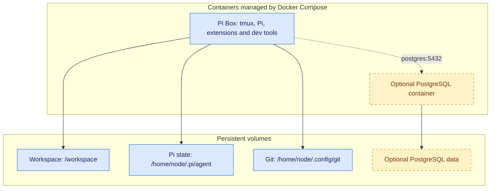

# pi-box

Pi-box is a lightweight development container setup built around the [Pi](https://pi.dev) agent harness.

Dev containers are particularly useful for agentic software engineering because they:

- Limit the damage from agent mistakes or malicious instructions by isolating their tools and filesystem access from the host system.
- When hosted remotely, provides a consistent environment for long-running processes like agent workflows that don't stop when your client connection drops or laptop lid closes.

This repo is a trimmed down version of the setup I am actively using for development - I've published it here both so anyone can use or adopt it, and as a demonstration (in lieu of a blog post) of how I'm working with agents/LLMs these days, and what tools and patterns I've found useful in my own work.

You can run this locally on your laptop, or on a home server/cloud VM and connect remotely over SSH (e.g. via Tailscale).

## Contents

- [Installation and usage](#installation-and-usage)
- [Architecture](#architecture)
- [Included packages and containers](#included-packages-and-containers)
  - [Packages and sidecars](#packages-and-sidecars)
  - [What about skills?](#what-about-skills)
- [Advanced setup and technical details](#advanced-setup-and-technical-details)
  - [Base image](#base-image)
  - [Git setup](#git-setup)
  - [Optional services: PostgreSQL](#optional-services-postgresql)
  - [Multiple Pi-box instances](#multiple-pi-box-instances)
  - [Running in a virtual machine](#running-in-a-virtual-machine)
  - [Tailscale](#tailscale)
  - [Updating extensions](#updating-extensions)

## Installation and usage

Prerequisites: Docker with Compose v2.24 or newer.

With Docker running, run:

```bash
git clone https://github.com/seitaro-white/pi-box.git
cd pi-box
docker compose up -d --build
```

Attach to the container's tmux session and start Pi:

```bash
docker compose exec pi-box tmux attach-session -t '=shell'
pi
```

There are also convenience targets in `Makefile`. The workspace, Pi settings and Git credentials are stored in persistent volumes and survive image rebuilds and container replacement


## Architecture

Pi-box includes a main dev container that contains Pi and basic dev tools, as well as an optional PostgreSQL sidecar. These are managed with Docker Compose.





The development container runs as the non-root `node` user, with Linux capabilities dropped and no host home directory or Docker socket mounted. This reduces privileges, but is **not a complete agent sandbox**: Pi can still modify or delete mounted files and use outbound network access to leak credentials available inside the container. Isolation does not prevent prompt injection; it limits what an agent following malicious instructions can reach.

## Included packages and containers

### Packages and sidecars

The default image includes:

- **Pi** — coding agent harness - model agnostic, minimal and easily extendable. Pi is great and you should check it out regardless of whether you use this container
- **tmux** - terminal multiplexer, for managing multiple terminal sessions/long-running processes.
- **Standard development tools:** Bash, Git, ripgrep, fd.
- **TUI navigation tools:** micro (file editor), bat (file pager), nnn (file explorer). Used in combination these allow for a very basic terminal-based development experience, very handy if ssh'ing in from a client system that lacks an IDE.

- **Python, uv and Ruff**
- **Node.js, npm and Biome**
- **PostgreSQL client (`psql`)**


- **Pi Extensions**
    - **`pi-subagents`** — spin up and delegate to subagents for parallel agent workflows.
    - **`pi-web-access`** — simple web access/search - useful to have this as a capability separate from any given model provider.
    - **`@narumitw/pi-lsp`** — Gives Pi access to the Ruff & Biome toolchain - you can catch a surprising number of issues in AI-generated code with good old-fashioned linting before you even get to agent reviews.
    - **`@narumitw/pi-usage`** — Usage dashboard for subscription based coding plans.

- **Sidecars**
    - **PostgreSQL Server** - Optional local database server intended for development/testing, not production.

### What about skills?

While I do have a set of development skills I use frequently, I'm of the opinion that skills a) are specific to the nature/requirements of individual projects & codebases, and b) are something best written yourself (or as part of a team) based on your requirements and experience of coding, so I've left them out.


## Advanced setup and technical details

### Base image

The default build target is `recommended`. A stripped-down `base` target includes Pi and the shared development tools, but omits the bundled Pi extensions, Ruff and Biome. To select it, set these overrides in your local `.env` before building:

```dotenv
TARGET=base
IMAGE=pi-box:0.2.0-base
```

### Git setup

Configure your Git identity inside the container and clone projects into `/workspace`. Git settings and HTTPS credentials persist in the Git volume; host Git configuration and SSH keys are not mounted automatically.

For private repositories, use a narrowly scoped token. The default credential helper stores tokens as plaintext in `/home/node/.config/git/credentials`: private file permissions protect them from other users, not from Pi or other processes running as the container user.

### Optional services: PostgreSQL

Optional services are added through Compose overlays. PostgreSQL is included as an example; select it in your private `.env`:

```dotenv
COMPOSE_FILE=compose.yaml:compose.postgres.yaml
POSTGRES_PASSWORD='your-private-password'
```

Run `make up` to build and start the selected services. Pi connects to `postgres:5432` using the supplied `PG*` environment variables; no database port is published to the host. It has database administrator access, so keep this separate from production data. PostgreSQL has its own persistent volume; changing `.env` does not rotate an existing database password.

Other development services can follow the same overlay pattern, with their own configuration and storage. Removing an overlay from the selection does not automatically stop its existing containers.

### Tailscale

Tailscale can provide private access to the Docker host or VM. Run it on the host and client, SSH to the host over your tailnet, then use `make attach` from the repository directory.

No Tailscale daemon or SSH server is needed inside Pi-box. This uses ordinary SSH over Tailscale, not the separate Tailscale SSH feature; configure host SSH access and tailnet rules accordingly. The host must remain awake and online.

### Updating extensions

Bundled Pi and extension versions are pinned in [`container/package.json`](container/package.json); Ruff is pinned separately in the `Dockerfile`. `make versions` checks the npm pins against registry versions without changing anything.

To change bundled packages, edit the manifest, regenerate the derived manifests/registrations with `container/prepare-runtime.mjs` for both image targets, and refresh both npm lockfiles. Commit those changes together, test both variants, then rebuild and recreate the container (`make up`). Replacing the container ends running sessions, so finish active work first.

Rebuilds retain persistent Pi settings, credentials and user-installed packages. Image-managed extension registrations are reconciled at startup; rebuilding does not reset your personal configuration.
