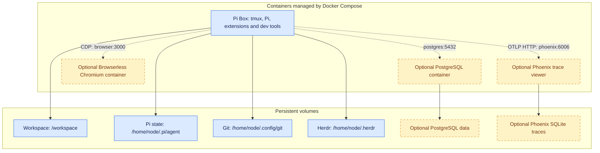

# pi-box

Pi-box is a lightweight development container setup built around the [Pi](https://pi.dev) agent harness.

Dev containers are particularly useful for agentic software engineering because they:

- Limit the damage from agent mistakes or malicious instructions by isolating their tools and filesystem access from the host system.
- When hosted remotely, provides a consistent environment for long-running processes like agent workflows that don't stop when your client connection drops or laptop lid closes.

This repo is a trimmed down version of the setup I am actively using for development - I've published it here both so anyone can use or adopt it, and as a demonstration (in lieu of a blog post) of how I'm working with agents/LLMs these days, and what tools and patterns I've found useful in my own work.

You can run this locally on your laptop, or on a home server/cloud VM and connect remotely over SSH (e.g. via Tailscale).

## Contents

- [Installation and usage](#installation-and-usage)
- [Architecture](#architecture)
- [Included packages and containers](#included-packages-and-containers)
  - [Packages and sidecars](#packages-and-sidecars)
  - [What about skills?](#what-about-skills)
- [Advanced setup and technical details](#advanced-setup-and-technical-details)
  - [Base image](#base-image)
  - [Git setup](#git-setup)
  - [Web development and browser access](#web-development-and-browser-access)
  - [Optional services: PostgreSQL](#optional-services-postgresql)
  - [Optional services: Browserless Chromium](#optional-services-browserless-chromium)
  - [Optional services: Phoenix tracing](#optional-services-phoenix-tracing)
  - [Multiple Pi-box instances](#multiple-pi-box-instances)
  - [Running in a virtual machine](#running-in-a-virtual-machine)
  - [Tailscale](#tailscale)
  - [Updating extensions](#updating-extensions)

## Installation and usage

Prerequisites for the existing Compose workflow: Docker Engine 25 or newer with Compose v5.0 or newer.

With Docker running, run:

```bash
git clone https://github.com/seitaro-white/pi-box.git
cd pi-box
docker compose up -d --build
```

Attach to the container's tmux session and start Pi:

```bash
docker compose exec pi-box tmux attach-session -t '=shell'
pi
```

There are also convenience targets in `Makefile`. The workspace, Pi settings, Git credentials and Herdr state are stored in persistent volumes and survive image rebuilds and container replacement


## Architecture

Pi-box includes a main dev container that contains Pi and basic dev tools, with optional PostgreSQL, Browserless Chromium and Phoenix tracing sidecars. These are managed with Docker Compose.





The development container runs as the non-root `node` user, with Linux capabilities dropped and no host home directory or Docker socket mounted. This reduces privileges, but is **not a complete agent sandbox**: Pi can still modify or delete mounted files and use outbound network access to leak credentials available inside the container. Isolation does not prevent prompt injection; it limits what an agent following malicious instructions can reach.

## Included packages and containers

### Packages and sidecars

The default image includes:

- **Pi** — coding agent harness - model agnostic, minimal and easily extendable. Pi is great and you should check it out regardless of whether you use this container
- **tmux** - terminal multiplexer, for managing multiple terminal sessions/long-running processes.
- **[Herdr](https://herdr.dev/)** (recommended image) — optional agent session manager, with its official `herdr` skill exposed to Pi. See [Pi-box setup and storage](docs/herdr.md).
- **[Hunk](https://hunk.dev/)** (recommended image) — interactive terminal diff reviewer, with its `hunk-review` skill exposed to Pi. See [Hunk](https://github.com/modem-dev/hunk).
- **Standard development tools:** Bash, Git, GitHub CLI (`gh`), Make, curl, ripgrep, fd (`fdfind` on Debian).
- **TUI navigation tools:** micro (file editor), bat (`batcat` on Debian, file pager), nnn (file explorer). Used in combination these allow for a very basic terminal-based development experience, very handy if ssh'ing in from a client system that lacks an IDE.

- **Python, uv, Ruff and [ty](https://docs.astral.sh/ty/)** — Ruff provides Python linting/fixes; ty provides type checking (`ty check`) and LSP diagnostics.
- **Node.js, npm and Biome**
- **[Claude Code CLI](https://code.claude.com/docs/)** (recommended and sandbox images) — run `claude` directly or `claude auth login` to authenticate for Claude Code and the bridge. In the recommended image, `CLAUDE_CONFIG_DIR` keeps Claude Code's login, settings and sessions in the agent volume (`~/.pi/agent/claude`), so they survive container replacement.
- **PostgreSQL client (`psql`)**


- **Pi Extensions**
    - **`pi-subagents`** — spin up and delegate to subagents for parallel agent workflows.
    - **`pi-web-access`** — simple web access/search - useful to have this as a capability separate from any given model provider.
    - **`@narumitw/pi-lsp`** — Gives Pi access to the Ruff, ty & Biome toolchain - you can catch a surprising number of issues in AI-generated code with good old-fashioned linting before you even get to agent reviews.
    - **`@narumitw/pi-usage`** — Usage dashboard for subscription based coding plans.
    - **`@juicesharp/rpiv-ask-user-question`** — structured questions with selectable answers.
    - **`@juicesharp/rpiv-todo`** — task tracking for multi-step work.
    - **[`pi-calm`](https://github.com/JesseZhang97/pi-calm)** — quieter tool output; toggle with `/calm`.
    - **`pi-stretchtext`** — expandable inline explanations that keep replies concise until you open the details.
    - **[`pi-context`](https://github.com/ttttmr/pi-context)** — `/context` usage dashboard only; its context-management tools and skill are disabled by package resource filters.
    - **[`pi-claude-bridge`](https://github.com/elidickinson/pi-claude-bridge)** — Claude Code-backed models in Pi, selected with `/model` under `claude-bridge`. Its Agent SDK includes the Claude Code executable; no separate CLI installation is needed to run the bridge. Configure Claude Code authentication separately; Pi's Anthropic login is not a substitute.
    - **[`@danielgap/pi-claude-usage`](https://github.com/danielgap/pi-claude-usage)** — Claude subscription usage in the status bar and `/claude:usage` panel while `claude-bridge` is selected; no Gentle Shell required. Uses your Claude Code subscription login (`claude auth login`) from `CLAUDE_CONFIG_DIR`; expired credentials must be refreshed by Claude Code.
    - **Herdr's official Pi integration** — Installed by `herdr integration install pi` at container startup; reports status and session identity, inactive outside Herdr.

- **Sidecars**
    - **PostgreSQL Server** - Optional local database server intended for development/testing, not production.
    - **Browserless Chromium** - Optional headless browser accessed over CDP; trusted development only, with SSPL/commercial licensing and Chromium's sandbox disabled upstream.
    - **Arize Phoenix** - Optional local trace viewer with SQLite storage. Requires explicit installation/configuration of `pi-otel`; full-content traces can retain private data and secrets.

Python files (`.py` and `.pyi`) automatically route to both Ruff and ty through pi-lsp's built-in catalog; no extra configuration is needed. `/lsp` shows command availability. A custom `pi-lsp.json` replaces that catalog, so existing custom configurations must include `{"ty":{"command":["ty","server"],"extensions":[".py",".pyi"]}}` alongside their other servers to enable ty.

### What about skills?

The recommended image bundles my [personal development skills](https://github.com/seitaro-white/personal-agent-skills) as a Pi package, including planning, review and cleanup workflows. Skills are project- and team-specific: treat these as starting points to adapt, not universal rules. It also includes the tool-specific `herdr` and `hunk-review` skills, which teach Pi how to control Herdr panes and interact with live Hunk review sessions.

The personal skills are fetched from `main` on each recommended or sandbox image build, independently of npm and its lockfile. Docker's BuildKit Git `ADD` resolves the branch on each build and reuses the cached contents only when the commit is unchanged. Use `make up` to rebuild and replace the Compose container; restarting an existing container does not update its skills. No startup pulls or runtime GitHub access are needed.

The `pi-calm` repository remains pinned to a full Git commit. Both repositories must be public for credential-free builds. No GitHub token is baked into the image.


## Advanced setup and technical details

### Base image

The default build target is `recommended`. A stripped-down `base` target includes Pi and the shared development tools, but omits Herdr, Hunk (including its skill), the bundled Pi extensions, Claude Code CLI, Ruff, ty and Biome. To select it, set these overrides in your local `.env` before building:

```dotenv
TARGET=base
IMAGE=pi-box:0.2.0-base
```

Both Compose variants include `/AGENTS.md` and a `pi-box` skill with environment
and service instructions. Replacing the image updates these without changing
personal Pi settings; use `/reload` in existing Pi sessions. uv Python/tool
installs persist in the agent volume.

### Git setup

Configure your Git identity inside the container and clone projects into `/workspace`. Git settings and HTTPS credentials persist in the Git volume; host Git configuration and SSH keys are not mounted automatically.

Use `gh` for GitHub PRs, issues and checks. Supply your existing GitHub token as
`GH_TOKEN` in the shell launching Pi; check with `gh auth status`. Git push/pull
keeps using its existing credential helper. CLI config persists in
`/home/node/.config/git/gh`; `GH_TOKEN` must be supplied for each new session.

### Docker Sandboxes

An optional mountless micro-VM deployment for Apple Silicon Macs uses native
`sbx env` commands and [`sbxenv.yaml`](sbxenv.yaml). See the
[sandbox guide](docs/sandboxes.md) for setup, login and storage options.
Internal storage survives stop/start, but not sandbox deletion.

### Web development and browser access

Compose publishes ports **5173–5182** on host loopback. Check `ss -ltnp`, choose
a free port, and bind to **`0.0.0.0`** with automatic port fallback disabled.

For Vite, set the project's dev script (using 5173 as an example):

```json
{
  "scripts": {
    "dev": "vite --host 0.0.0.0 --port 5173 --strictPort"
  }
}
```

Run `npm run dev`. Pi's optional Browserless browser visits
**`http://pi-box:5173`**; your host browser needs no sidecar.

Use the selected port in both URLs. To remap the ten host ports, set
`DEV_PORTS=15173-15182` in `.env` and run `make up` (ends sessions if Pi is recreated).
Container ports stay 5173–5182.

For remote viewing, run on your client machine:

```bash
ssh -N -o ExitOnForwardFailure=yes -L 127.0.0.1:5173:127.0.0.1:5173 your-mac-ssh-alias
```

Visit `http://localhost:5173` while the tunnel is open. Repeat `-L` for additional
ports; use the mapped host port as the destination if you changed `DEV_PORTS`.

### Optional services: PostgreSQL

Optional services are added through Compose overlays. PostgreSQL is included as an example; select it in your private `.env`:

```dotenv
COMPOSE_FILE=compose.yaml:compose.postgres.yaml
POSTGRES_PASSWORD='your-private-password'
```

Run `make up` to build and start the selected services. Pi connects to `postgres:5432` using the supplied `PG*` environment variables; no database port is published to the host. It has database administrator access, so keep this separate from production data. PostgreSQL has its own persistent volume; changing `.env` does not rotate an existing database password.

Combine overlays by appending their filenames to `COMPOSE_FILE`. Stop a sidecar
before removing its overlay; deselecting it alone leaves the container running.

### Optional services: Browserless Chromium

Select the browser overlay in your private `.env`:

```dotenv
COMPOSE_FILE=compose.yaml:compose.browserless.yaml
BROWSER_TOKEN='your-own-strong-private-token'
```

Run `chmod 600 .env` and `make up`. Pi receives `BROWSER_CDP_URL` and
`BROWSER_TOKEN`. See the [Browserless guide](docs/browserless.md) for a client
example and licensing/security details.

### Optional services: Phoenix tracing

Select Phoenix in your private `.env`:

```dotenv
COMPOSE_FILE=compose.yaml:compose.phoenix.yaml
```

Run `make up`, then follow the [Phoenix guide](docs/phoenix.md) to install and
configure `pi-otel`. The UI is at `http://localhost:6006`; traces persist in SQLite.
**Full-content traces can retain prompts, code, tool results and secrets.**

### Tailscale

Tailscale can provide private access to the Docker host or VM. Run it on the host and client, SSH to the host over your tailnet, then run `docker compose exec -it pi-box bash -l` from the repository directory and manage sessions yourself.

The host must remain awake and online.

### Updating extensions

Bundled Pi and extension versions are pinned in [`container/package.json`](container/package.json), except personal skills, which follow `main` at build time; Ruff, ty, Herdr and Hunk are pinned by `ARG`s in `Dockerfile`. Herdr is also verified against per-architecture SHA-256 checksums; update them with its version from `https://herdr.dev/latest.json`. `make versions` checks the npm pins against registry versions without changing anything, and labels Git commit pins without checking upstream. Update Git packages by replacing their full commit hashes in the manifest.

To change bundled packages, edit the manifest, regenerate the derived manifests/registrations with `container/prepare-runtime.mjs` for both image targets, and refresh both npm lockfiles. Commit those changes together, test both variants, then rebuild and recreate the container (`make up`). Replacing the container ends running sessions, so finish active work first.

Rebuilds retain persistent Pi settings, credentials and user-installed packages. Image-managed extension registrations are reconciled at startup; rebuilding does not reset your personal configuration.

## Testing

`npm test` runs the small Docker-free suite for state preservation, replacement guards and runtime-manifest consistency. `npm run test:integration` runs disposable Docker acceptance against prebuilt base, recommended and sandbox images, including Compose persistence, PostgreSQL and Browserless. Phoenix and live sandbox checks are explicitly opt-in.

See [the test guide](tests/README.md) for image-build commands, suite selection and cleanup behaviour. CI uses the same acceptance runner on AMD64 and ARM64.
