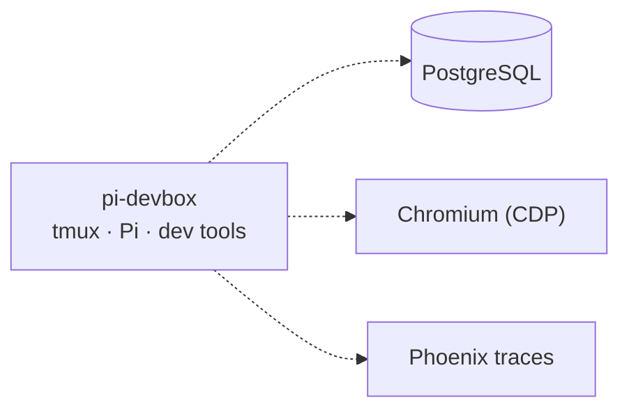

# Pi-devbox

A lightweight dev container for coding agents, built around the [Pi](https://pi.dev) agent harness, that I have been using for my work.

[Quick start](#quick-start) 

[Architecture](#architecture) 

[What's included](#whats-included) 

[Advanced docs](docs/advanced.md) 


## Why?

Dev containers are particularly useful for agentic software engineering because they:

- **Limit the damage** from agent mistakes or malicious instructions by isolating their tools and filesystem access from the host system.
- **Keep long-running work alive** when hosted remotely: agent workflows don't stop when your client connection drops or laptop lid closes.

This repo is a trimmed down version of the setup I am actively using for development. I've published it so anyone can use or adopt it, and as a demonstration (in lieu of a blog post) of how I'm working with agents/LLMs these days, and what tools and patterns I've found useful.

Run it locally on your laptop, or on a home server/cloud VM and connect remotely over SSH (e.g. via Tailscale).

## Quick start

Prerequisites: Docker Engine 25 or newer with Compose v5.0 or newer.

```bash
git clone https://github.com/seitaro-white/pi-devbox.git
cd pi-devbox
docker compose up -d --build
```

Attach to the container's tmux session and start Pi:

```bash
docker compose exec pi-box tmux attach-session -t '=shell'
pi
```

There are also convenience targets in `Makefile`. The workspace, Pi settings, Git credentials and Herdr state live in persistent volumes and survive image rebuilds and container replacement.

## Architecture

Pi-devbox includes a main dev container that contains Pi and basic dev tools, and a few optional sidecar containers for Postgre, Browserless Chromium and Phoenix tracing. Managed with Docker compose



## What's included

### Packages

The default image includes:

- **Pi** — The core agent harness - model agnostic, minimal and easily extendable.
- **tmux** - terminal multiplexer, for managing multiple terminal sessions/long-running processes.
- **[Herdr](https://herdr.dev/)** (recommended image) — optional agent session manager, with its official `herdr` skill exposed to Pi. See [Pi-devbox setup and storage](docs/herdr.md).
- **[Hunk](https://hunk.dev/)** (recommended image) — interactive terminal diff reviewer, with its `hunk-review` skill exposed to Pi. See [Hunk](https://github.com/modem-dev/hunk).
- **Standard development tools:** Bash, Git, GitHub CLI (`gh`), Make, curl, ripgrep, fd (`fdfind` on Debian).
- **TUI navigation tools:** micro (file editor), bat (`batcat` on Debian, file pager), nnn (file explorer). Used in combination these allow for a very basic terminal-based development experience, very handy if ssh'ing in from a client system that lacks an IDE.

- **Python, uv, Ruff and [ty](https://docs.astral.sh/ty/)** — Ruff provides Python linting/fixes; ty provides type checking (`ty check`) and LSP diagnostics.
- **Node.js, npm and Biome**
- **[Claude Code CLI](https://code.claude.com/docs/)** (recommended and sandbox images) — run `claude` directly or `claude auth login` to authenticate for Claude Code and the bridge. In the recommended image, `CLAUDE_CONFIG_DIR` keeps Claude Code's login, settings and sessions in the agent volume (`~/.pi/agent/claude`), so they survive container replacement.
- **PostgreSQL client (`psql`)**
- **Google Cloud CLI (`gcloud`, `gsutil`, `bq`) and Terraform** — pinned, checksum-verified Linux amd64/arm64 releases in every image. Compose keeps gcloud configuration and credentials in the agent volume (`~/.pi/agent/gcloud`).

- **Pi Extensions**
    - **`pi-subagents`** — spin up and delegate to subagents for parallel agent workflows.
    - **`pi-web-access`** — simple web access/search - useful to have this as a capability separate from any given model provider.
    - **`@narumitw/pi-lsp`** — Gives Pi access to the Ruff, ty & Biome toolchain - you can catch a surprising number of issues in AI-generated code with good old-fashioned linting before you even get to agent reviews.
    - **`@narumitw/pi-usage`** — Usage dashboard for subscription based coding plans.
    - **`@juicesharp/rpiv-ask-user-question`** — structured questions with selectable answers.
    - **`@juicesharp/rpiv-todo`** — task tracking for multi-step work.
    - **[`pi-calm`](https://github.com/JesseZhang97/pi-calm)** — quieter tool output; toggle with `/calm`.
    - **`pi-stretchtext`** — expandable inline explanations that keep replies concise until you open the details.
    - **[`pi-context-view`](https://github.com/dimk90/pi-context-view)** — interactive `/context` usage explorer and `/context injections` inspector for system prompts, tool definitions, and extension contributions.
    - **[`pi-claude-bridge`](https://github.com/elidickinson/pi-claude-bridge)** — Claude Code-backed models in Pi, selected with `/model` under `claude-bridge`. Its Agent SDK includes the Claude Code executable; no separate CLI installation is needed to run the bridge. Configure Claude Code authentication separately; Pi's Anthropic login is not a substitute.
    - **[`@danielgap/pi-claude-usage`](https://github.com/danielgap/pi-claude-usage)** — Claude subscription usage in the status bar and `/claude:usage` panel while `claude-bridge` is selected; no Gentle Shell required. Uses your Claude Code subscription login (`claude auth login`) from `CLAUDE_CONFIG_DIR`; expired credentials must be refreshed by Claude Code.
    - **Herdr's official Pi integration** — Installed by `herdr integration install pi` at container startup; reports status and session identity, inactive outside Herdr.

- **Sidecars**
    - **PostgreSQL Server** - Optional local database server intended for development/testing, not production.
    - **Browserless Chromium** - Optional headless browser accessed over CDP; trusted development only, with SSPL/commercial licensing and Chromium's sandbox disabled upstream.
    - **Arize Phoenix** - Optional local trace viewer with SQLite storage. Requires explicit installation/configuration of `pi-otel`; full-content traces can retain private data and secrets.

### What about skills?

The recommended image bundles my [personal development skills](https://github.com/seitaro-white/personal-agent-skills) as a Pi package, including planning, review and cleanup workflows. Skills are project- and team-specific: treat these as starting points to adapt, not universal rules. It also includes the tool-specific `herdr` and `hunk-review` skills, which teach Pi how to control Herdr panes and interact with live Hunk review sessions.

## Documentation

- [Advanced setup and technical details](docs/advanced.md): Git and cloud tools, web dev ports, optional services, Tailscale, LSP and skills build details, updating extensions, testing
- [Herdr](docs/herdr.md) · [Browserless](docs/browserless.md) · [Phoenix](docs/phoenix.md) · [Docker Sandboxes](docs/sandboxes.md) · [Tests](tests/README.md)
