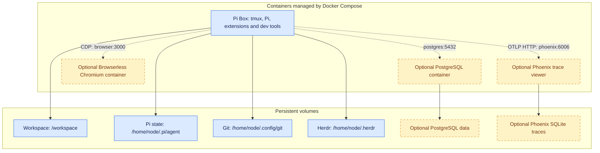

# pi-box

Pi-box is a lightweight development container setup built around the [Pi](https://pi.dev) agent harness.

Dev containers are particularly useful for agentic software engineering because they:

- Limit the damage from agent mistakes or malicious instructions by isolating their tools and filesystem access from the host system.
- When hosted remotely, provides a consistent environment for long-running processes like agent workflows that don't stop when your client connection drops or laptop lid closes.

This repo is a trimmed down version of the setup I am actively using for development - I've published it here both so anyone can use or adopt it, and as a demonstration (in lieu of a blog post) of how I'm working with agents/LLMs these days, and what tools and patterns I've found useful in my own work.

You can run this locally on your laptop, or on a home server/cloud VM and connect remotely over SSH (e.g. via Tailscale).

## Contents

- [Installation and usage](#installation-and-usage)
- [Architecture](#architecture)
- [Included packages and containers](#included-packages-and-containers)
  - [Packages and sidecars](#packages-and-sidecars)
  - [What about skills?](#what-about-skills)
- [Advanced setup and technical details](#advanced-setup-and-technical-details)
  - [Base image](#base-image)
  - [Git setup](#git-setup)
  - [Web development and browser access](#web-development-and-browser-access)
  - [Optional services: PostgreSQL](#optional-services-postgresql)
  - [Optional services: Browserless Chromium](#optional-services-browserless-chromium)
  - [Optional services: Phoenix tracing](#optional-services-phoenix-tracing)
  - [Multiple Pi-box instances](#multiple-pi-box-instances)
  - [Running in a virtual machine](#running-in-a-virtual-machine)
  - [Tailscale](#tailscale)
  - [Updating extensions](#updating-extensions)

## Installation and usage

Prerequisites for the existing Compose workflow: Docker with Compose v5.0 or newer.

With Docker running, run:

```bash
git clone https://github.com/seitaro-white/pi-box.git
cd pi-box
docker compose up -d --build
```

Attach to the container's tmux session and start Pi:

```bash
docker compose exec pi-box tmux attach-session -t '=shell'
pi
```

There are also convenience targets in `Makefile`. The workspace, Pi settings, Git credentials and Herdr state are stored in persistent volumes and survive image rebuilds and container replacement


## Architecture

Pi-box includes a main dev container that contains Pi and basic dev tools, with optional PostgreSQL, Browserless Chromium and Phoenix tracing sidecars. These are managed with Docker Compose.





The development container runs as the non-root `node` user, with Linux capabilities dropped and no host home directory or Docker socket mounted. This reduces privileges, but is **not a complete agent sandbox**: Pi can still modify or delete mounted files and use outbound network access to leak credentials available inside the container. Isolation does not prevent prompt injection; it limits what an agent following malicious instructions can reach.

## Included packages and containers

### Packages and sidecars

The default image includes:

- **Pi** — coding agent harness - model agnostic, minimal and easily extendable. Pi is great and you should check it out regardless of whether you use this container
- **tmux** - terminal multiplexer, for managing multiple terminal sessions/long-running processes.
- **[Herdr](https://herdr.dev/)** (recommended image) — optional agent session manager, with its official `herdr` skill exposed to Pi. See [Pi-box setup and storage](docs/herdr.md).
- **[Hunk](https://hunk.dev/)** (recommended image) — interactive terminal diff reviewer, with its `hunk-review` skill exposed to Pi. See [Hunk review workflow](docs/hunk.md).
- **Standard development tools:** Bash, Git, curl, ripgrep, fd (`fdfind` on Debian).
- **TUI navigation tools:** micro (file editor), bat (`batcat` on Debian, file pager), nnn (file explorer). Used in combination these allow for a very basic terminal-based development experience, very handy if ssh'ing in from a client system that lacks an IDE.

- **Python, uv and Ruff**
- **Node.js, npm and Biome**
- **PostgreSQL client (`psql`)**


- **Pi Extensions**
    - **`pi-subagents`** — spin up and delegate to subagents for parallel agent workflows.
    - **`pi-web-access`** — simple web access/search - useful to have this as a capability separate from any given model provider.
    - **`@narumitw/pi-lsp`** — Gives Pi access to the Ruff & Biome toolchain - you can catch a surprising number of issues in AI-generated code with good old-fashioned linting before you even get to agent reviews.
    - **`@narumitw/pi-usage`** — Usage dashboard for subscription based coding plans.
    - **Herdr's official Pi integration** — Installed by `herdr integration install pi` at container startup; reports status and session identity, inactive outside Herdr.

- **Sidecars**
    - **PostgreSQL Server** - Optional local database server intended for development/testing, not production.
    - **Browserless Chromium** - Optional headless browser accessed over CDP; trusted development only, with SSPL/commercial licensing and Chromium's sandbox disabled upstream.
    - **Arize Phoenix** - Optional local trace viewer with SQLite storage. Requires explicit installation/configuration of `pi-otel`; full-content traces can retain private data and secrets.

### What about skills?

While I do have a set of development skills I use frequently, I'm of the opinion that skills a) are specific to the nature/requirements of individual projects & codebases, and b) are something best written yourself (or as part of a team) based on your requirements and experience of coding, so general-purpose development skills are left out. The recommended image does include the tool-specific `herdr` and `hunk-review` skills, which teach Pi how to control Herdr panes and interact with live Hunk review sessions.


## Advanced setup and technical details

### Base image

The default build target is `recommended`. A stripped-down `base` target includes Pi and the shared development tools, but omits Herdr, Hunk (including its skill), the bundled Pi extensions, Ruff and Biome. To select it, set these overrides in your local `.env` before building:

```dotenv
TARGET=base
IMAGE=pi-box:0.2.0-base
```

Both Compose image variants include short, always-loaded environment instructions
at `/AGENTS.md` and a discoverable `pi-box` skill under
`/home/node/.agents/skills/pi-box`. They explain optional-service discovery,
Browserless CDP, dev-server binding and host/SSH access. These are image-owned,
outside the persistent volumes, so rebuilding/replacing Pi updates them without
overwriting personal `~/.pi/agent/AGENTS.md` or settings. Run Pi's `/reload` after
guidance changes in a running environment. The Docker Sandbox image does not
currently bundle this Compose-specific guidance.

Runtime defaults follow the sandbox where possible: Pi uses `~/.pi/agent`, checks for updates normally, and the pager is `batcat`. Compose keeps install telemetry disabled and redirects later uv Python/tool installs into the persistent agent volume; these installs survive container replacement.

### Git setup

Configure your Git identity inside the container and clone projects into `/workspace`. Git settings and HTTPS credentials persist in the Git volume; host Git configuration and SSH keys are not mounted automatically.

For private repositories, use a narrowly scoped token. The default credential helper stores tokens as plaintext in `/home/node/.config/git/credentials`: private file permissions protect them from other users, not from Pi or other processes running as the container user.

**Docker Sandboxes (opt-in):** a mountless micro-VM deployment is available for
Apple Silicon Macs, managed with native `sbx env` commands and [`sbxenv.yaml`](sbxenv.yaml).
See the [sandbox setup guide](docs/sandboxes.md) for installation, Codex `/login`,
host-proxied GitHub access, and manual session management.
Compose remains the primary workflow, with reusable named volumes. The optional
sandbox defaults to internal storage that survives stop/start but not deletion;
[shared host-directory storage](docs/sandboxes.md#optional-shared-storage) is also
documented. Neither path migrates or deletes the other's storage.

### Web development and browser access

Compose publishes container port **5173** at **http://localhost:5173** on the
Docker host, bound only to `127.0.0.1` (not the LAN or Tailscale interface).
Your host browser and Pi's optional Browserless browser visit the same app,
but have separate tabs, cookies and sessions; no browser mirroring is involved.

The app must listen on **`0.0.0.0:5173` inside Pi**. Set this once per project
in its dev-server configuration or `package.json` script. For Vite:

```json
{
  "scripts": {
    "dev": "vite --host 0.0.0.0 --port 5173 --strictPort"
  }
}
```

Then just run `npm run dev` inside the project. `--strictPort` prevents Vite
silently choosing an unpublished port when 5173 is busy. Other frameworks need
their equivalent host/port settings; Compose does not configure the app itself.
Only one app can use container port 5173 at a time.

Pi's Browserless sidecar visits **`http://pi-box:5173`** and should connect using
`BROWSER_CDP_URL` and `BROWSER_TOKEN`, not launch Chromium inside Pi. See the
[Browserless guide](docs/browserless.md). Browserless is not needed for manual
viewing in your host browser.

For another host port (for example, multiple Pi Box instances), set
`DEV_PORT=15173` in private `.env`, then apply with `make up`. Open
`http://localhost:15173`; the app and Browserless still use container port 5173.
Applying port changes recreates Pi and ends active sessions, so finish work first.
Existing installations must also apply this Compose change before the port is
available. This port publishing applies to Compose, not Docker Sandboxes.

**Viewing from another machine (e.g. ThinkPad → Mac over Tailscale):**

```bash
# Run on the viewing machine; use your existing SSH hostname/alias for the Docker host.
ssh -N -o ExitOnForwardFailure=yes -L 127.0.0.1:5173:127.0.0.1:5173 your-mac-ssh-alias
```

Keep that connection open and visit `http://localhost:5173` on the ThinkPad.
`-N` opens only the tunnel; keep your normal Pi terminal connection separately.
No Tailscale changes or SSH server in the container are needed, provided your
existing host SSH access allows TCP forwarding. No Mac zsh alias changes are
needed for local viewing. You can save the tunnel once in the ThinkPad's
`~/.ssh/config` under a dedicated alias:

```sshconfig
Host pi-box-web
    HostName your-mac-tailscale-name
    User your-mac-user
    LocalForward 127.0.0.1:5173 127.0.0.1:5173
    ExitOnForwardFailure yes
```

Then run `ssh -N pi-box-web`. If the ThinkPad's port 5173 is occupied, change
only the first port to 15173 and browse `http://localhost:15173`. If the Docker
host uses a custom `DEV_PORT`, change the destination (last) port accordingly.
Do not expose the dev server publicly or use Tailscale Serve/Funnel for this workflow.

### Optional services: PostgreSQL

Optional services are added through Compose overlays. PostgreSQL is included as an example; select it in your private `.env`:

```dotenv
COMPOSE_FILE=compose.yaml:compose.postgres.yaml
POSTGRES_PASSWORD='your-private-password'
```

Run `make up` to build and start the selected services. Pi connects to `postgres:5432` using the supplied `PG*` environment variables; no database port is published to the host. It has database administrator access, so keep this separate from production data. PostgreSQL has its own persistent volume; changing `.env` does not rotate an existing database password.

Other development services can follow the same overlay pattern, with their own configuration and storage. Removing an overlay from the selection does not automatically stop its existing containers.

### Optional services: Browserless Chromium

Select the browser overlay in your private `.env`:

```dotenv
COMPOSE_FILE=compose.yaml:compose.browserless.yaml
BROWSER_TOKEN='your-own-strong-private-token'
```

Run `chmod 600 .env` and `make up`. Pi receives `BROWSER_CDP_URL` and `BROWSER_TOKEN`; install your own browser client in your project. To include PostgreSQL too, use `COMPOSE_FILE=compose.yaml:compose.postgres.yaml:compose.browserless.yaml` and also set `POSTGRES_PASSWORD`.

The pinned upstream browser publishes no host ports and has no persistent storage. It uses **SSPL/commercial licensing** and disables Chromium's sandbox, so use it only for trusted development. See the [Browserless guide](docs/browserless.md) for client examples, session cleanup, licensing and security details.

### Optional services: Phoenix tracing

Select Phoenix in your private `.env`:

```dotenv
COMPOSE_FILE=compose.yaml:compose.phoenix.yaml
```

Or append `:compose.phoenix.yaml` to an existing PostgreSQL/Browserless selection. Run `make up`, then follow the [Phoenix guide](docs/phoenix.md) to explicitly configure and install the pinned `pi-otel` exporter inside Pi Box. Starting the backend alone does not enable tracing or change Pi's default packages/settings.

The unauthenticated UI binds only to host loopback at `http://localhost:6006`; traces persist in a project-scoped SQLite volume. **Full-content capture can retain prompts, code, tool results and secrets.** Review the guide's privacy, shutdown and deletion instructions before enabling it. Remote viewing uses SSH forwarding, not a public port.

### Tailscale

Tailscale can provide private access to the Docker host or VM. Run it on the host and client, SSH to the host over your tailnet, then run `docker compose exec -it pi-box bash -l` from the repository directory and manage sessions yourself.

No Tailscale daemon or SSH server is needed inside Pi-box. This uses ordinary SSH over Tailscale, not the separate Tailscale SSH feature; configure host SSH access and tailnet rules accordingly. The host must remain awake and online.

### Updating extensions

Bundled Pi and extension versions are pinned in [`container/package.json`](container/package.json); Ruff is pinned separately in the `Dockerfile`. `make versions` checks the npm pins against registry versions without changing anything.

To change bundled packages, edit the manifest, regenerate the derived manifests/registrations with `container/prepare-runtime.mjs` for both image targets, and refresh both npm lockfiles. Commit those changes together, test both variants, then rebuild and recreate the container (`make up`). Replacing the container ends running sessions, so finish active work first.

Rebuilds retain persistent Pi settings, credentials and user-installed packages. Image-managed extension registrations are reconciled at startup; rebuilding does not reset your personal configuration.

Very old installations using Compose services named `pi`/`db` must be stopped and migrated manually before starting the current services. Volumes predating `pi-box-packages.json` ownership tracking may need obsolete image-package registrations removed manually; startup no longer guesses which existing registrations it owns.

## Testing

`npm test` runs the small Docker-free suite for state preservation, replacement guards and runtime-manifest consistency. `npm run test:integration` runs disposable Docker acceptance against prebuilt base, recommended and sandbox images, including Compose persistence, PostgreSQL and Browserless. Phoenix and live sandbox checks are explicitly opt-in.

See [the test guide](tests/README.md) for image-build commands, suite selection and cleanup behaviour. CI uses the same acceptance runner on AMD64 and ARM64.
