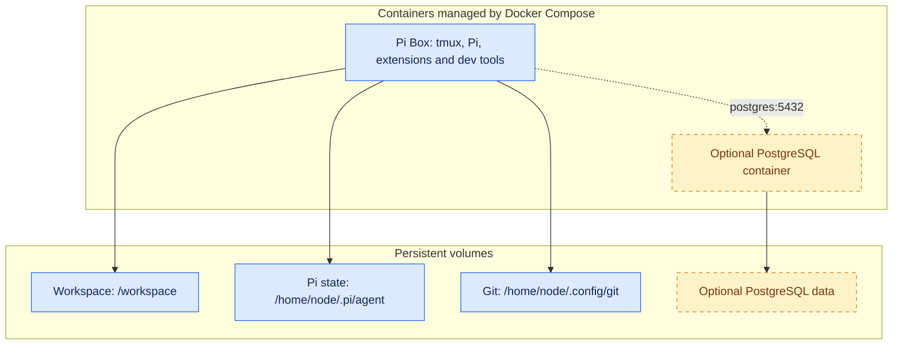

# pi-box

Pi-box is a lightweight development container setup build around the [Pi](https://pi.dev) agent harness.

Dev containers are are particularly useful for agentic software engineering because they:

- Provide a enclosed sandbox environment that agents can operate in with much less risk of xyz
- Facilitate the managing of long-running processes (i.e. agent workflows) that don't stop when you lose internet connection or close your laptop lid.

This repo is a trimmed down version of the setup I am actively using for development - I've published it here both so anyone can use or adopt it, and as a demonstration (in lieu of a blog post) of how I'm working with agents/llm these days, and what tools and patters I've found useful in my own work.

## Contents

- [Installation](#installation)
- [Basic usage](#basic-usage)
- [Architecture at a glance](#architecture-at-a-glance)
- [Included packages and containers](#included-packages-and-containers)
  - [Packages](#packages)
  - [Containers](#containers)
  - [What's not included](#whats-not-included)
- [Advanced setup and technical details](#advanced-setup-and-technical-details)
  - [Git setup](#git-setup)
  - [Running additional containers](#running-additional-containers)
  - [Per-container configuration](#per-container-configuration)
  - [Running in a virtual machine](#running-in-a-virtual-machine)
  - [Tailscale](#tailscale)
  - [Updating extensions](#updating-extensions)

## Installation & Useage

Pre-requisites: Docker (with Compose v5.0+), Node, Npm and Make.

With Docker running, run:

```bash
git clone https://github.com/seitaro-white/pi-box.git
cd pi-box
docker compose up
```

To get into the container and start working

```bash
docker compose exec pi-box bash
pi
```

```bash
tmux attach-session -t SESSION_NAME
pi
```

There are also some convinience alias in Makefile. The environment is set up so that pi settings and git credentials are stored in persistent volumes and survive image rebuild.


## Architecture

Pi box includes a main dev container that contains Pi and basic dev tools, as well as a set of optional side containers. These are managed with Docker Compose





The development container runs as the non-root `node` user, with Linux capabilities dropped and no host home directory or Docker socket mounted. This reduces privileges, but is **not a complete agent sandbox**: Pi can still access its mounted files, credentials and outbound network.

## Included packages and containers

<!-- Starting inventory below; add your own rationale or links where useful. -->

### Packages and sidecars

Both image variants share the development tools. The **recommended** image adds the bundled extensions and lint/format tooling; **base** omits those additions.

**Both variants:**

- **Pi** — coding agent harness - model agnostic, minimal and easily extendable. Pi is great and you should check it out regardless of whether you use this container
- **tmux** - terminal multiplexer, for managing multiple terminal sessions/long-running processes.
- **Standard development tools:** Bash, Git, ripgrep, fd,
- **Tui navigation tools:** micro (file editor), bat (file pager), nnn (file explorer). Used in combination these allow for a very basic terminal-based development experience, very handy if ssh'ing in from a client system that lacks an IDE.

- **Python, uv and ruff**
- **Node.js, npm and biome**
- **PostgreSQL client (`psql`)**


- **Pi Extensions**
    - **`pi-subagents`** — spin up and delegate to subagents for parallel agent workflows.
    - **`pi-web-access`** — simple web access/search - useful to have this as a capability separate from any given model provider.
    - **`@narumitw/pi-lsp`** — Gives pi access to the Ruff & Biome toolchain - you can catch a suprising number of issues in AI generated code with good old fashioned linting and typechecking before you even get to agent reviews.
    - **`@narumitw/pi-usage`** — Usage dashboard for subscription based coding plans.

- **Sidecars**
    - **PostgreSQL Server** - Optional local SQL server (as a dev/testing tool for Pi, not an actual DB!)

***What about skills?***
While I do have a set of development skills I use frequently, I'm of the opinion that skills a) specific to the nature/requirements of individual projects & codebases, and b) are something best written yourself (or as part of a team) based on your requirements and experience of coding, so I've left them out.


## Advanced setup and technical details

### Git setup

<!-- Optional: include only project-specific setup, rather than general Git instructions. -->

### Running additional containers

<!-- Explain how to start and manage additional containers. -->

### Per-container configuration

<!-- Document any individual setup required for those containers. -->

### Running in a virtual machine

<!-- TODO: document this once VM support has been set up and tested. -->

### Tailscale

<!-- Explain any Tailscale setup and usage specific to this project. -->

### Updating extensions

<!-- Explain how to update extensions. -->
