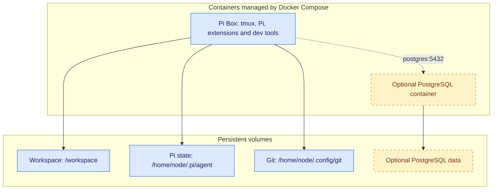

# pi-box

Pi-box is a lightweight development container setup build around the [Pi](https://pi.dev) agent harness.


- Provide the PI agent harness with suitable development environment and appriate tools within a containerised sandbox (rather than running it directly on your local system)
- Allows for remove development, with the container hosted on a home server or cloud VM and agentic work

Pi box is a (slightly trimmed down) version of what I am actually using for development - I've published it publicly both with the hope that others might use or adopt from it, but also as a demonstration (in lieu of a blog post) of how I'm working with agents/llm these days, what tools and patters Ni've found useful in my own work.

## Contents

- [Installation](#installation)
- [Basic usage](#basic-usage)
- [Architecture at a glance](#architecture-at-a-glance)
- [Included packages and containers](#included-packages-and-containers)
  - [Packages](#packages)
  - [Containers](#containers)
  - [What's not included](#whats-not-included)
- [Advanced setup and technical details](#advanced-setup-and-technical-details)
  - [Git setup](#git-setup)
  - [Running additional containers](#running-additional-containers)
  - [Per-container configuration](#per-container-configuration)
  - [Running in a virtual machine](#running-in-a-virtual-machine)
  - [Tailscale](#tailscale)
  - [Updating extensions](#updating-extensions)

## Installation

Pre-requisites: Docker (with Compose v5.0+), Node, Npm and Make.

With Docker running, run:

```bash
git clone https://github.com/seitaro-white/pi-box.git
cd pi-box
docker compose up
```

Go directly to shell with `docker compose exec pi-box bash` or (highly recommended) via tmux with `tmux attach-session -t shell`


## Basic usage

Once in, you can use the container as you would normally use any development environment. The environment is set up so that pi settings and git credentials are stored in persistent volumes and survive image rebuild.


## Architecture at a glance

Pi Box is one development container, managed by Docker Compose. Pi and the development tools run together inside it; tmux keeps the interactive session alive when you disconnect. Optional services, such as PostgreSQL, run in separate containers on the Compose network.



[`compose.yaml`](compose.yaml) defines Pi Box and its three persistent volumes. Selecting [`compose.postgres.yaml`](compose.postgres.yaml) alongside it adds the database and Pi's connection settings; no database port is published to the host. SSH and Tailscale, if used, run on the host—not inside Pi Box.

The development container runs as the non-root `node` user, with Linux capabilities dropped and no host home directory or Docker socket mounted. This reduces privileges, but is **not a complete agent sandbox**: Pi can still access its mounted files, credentials and outbound network.

## Included packages and containers

<!-- Starting inventory below; add your own rationale or links where useful. -->

### Packages and sidecars

Both image variants share the development tools. The **recommended** image adds the bundled extensions and lint/format tooling; **base** omits those additions.

**Both variants:**

- **Pi** — coding agent harness - model agnostic, minimal and easily extendable.
- **tmux** - terminal multiplexer, for managing multiple terminal sessions and allowing background AI work.
- **Standard development tools:** Bash, Git, tmux, ripgrep, fd,
- **Tui navigation tools:** micro (tui file editor), bat (tui file pager), nnn (tui file explorer). Used in combination these allow for a very basic terminal-based development experience, very handy if ssh'ing in from a client system that lacks an IDE.

- **Python, uv and ruff**
- **Node.js, npm and biome**
- **PostgreSQL client (`psql`)**


- **Pi Extensions**
    - **`pi-subagents`** — spin up and delegate to subagents for parallel agent workflows.
    - **`pi-web-access`** — simple web access/search - useful to have this as a capability separate from any given model provider.
    - **`@narumitw/pi-lsp`** — Gives pi access to the Ruff & Biome toolchain - you can catch a suprising number of issues in AI generated code with good old fashioned linting and typechecking before you even get to agent reviews.
    - **`@narumitw/pi-usage`** — Usage dashboard for subscription based coding plans.

- **Sidecars**
    - **PostgreSQL Server** - Optional local SQL server (as a dev/testing tool for Pi, not an actual DB!)

***What about skills?***
While I do have a set of development skills I use frequently, I'm of the opinion that skills a) specific to the nature/requirements of individual projects & codebases, and b) are something best written yourself (or as part of a team) based on your requirements and experience of coding, so I've left them out.


<!-- Add any personal rationale here. Exact npm pins live in container/package.json. -->

### Containers

| Service | Default container name | Enabled by default? | Role / storage |
| --- | --- | --- | --- |
| `pi-box` | `pi-box-main-container` | Yes | Development environment; persistent workspace, Pi state and Git configuration volumes. |
| `postgres` | `pi-box-postgres-container` | No | Optional PostgreSQL 15 database; its own persistent data volume. Enabled through `compose.postgres.yaml`. |

Use service names with `docker compose`, e.g. `docker compose exec pi-box bash`. The `pi` command inside the container starts the agent. The development container name can be overridden with `CONTAINER`; the database container name follows `<project>-postgres-container` (the default project is `pi-box`).

<!-- Add future optional services here when implemented. -->

### What's not included

<!-- Note deliberate omissions and anything users need to provide themselves. -->

## Advanced setup and technical details

### Git setup

<!-- Optional: include only project-specific setup, rather than general Git instructions. -->

### Running additional containers

<!-- Explain how to start and manage additional containers. -->

### Per-container configuration

<!-- Document any individual setup required for those containers. -->

### Running in a virtual machine

<!-- TODO: document this once VM support has been set up and tested. -->

### Tailscale

<!-- Explain any Tailscale setup and usage specific to this project. -->

### Updating extensions

<!-- Explain how to update extensions. -->
