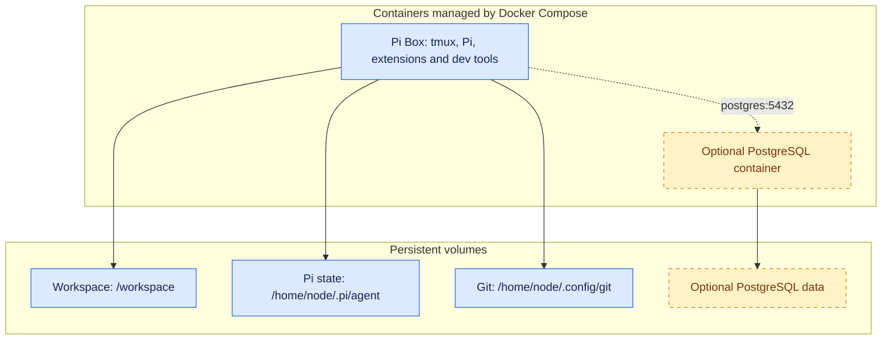

# pi-box

Pi-box is a lightweight development container setup built around the [Pi](https://pi.dev) agent harness.

Dev containers are particularly useful for agentic software engineering because they:

- Limit the damage from agent mistakes or malicious instructions by isolating their tools and filesystem access from the host system.
- Provide a consistent environment for long-running processes like agent workflows that don't stop when your connection drops or laptop lid closes.

This repo is a trimmed down version of the setup I am actively using for development - I've published it here both so anyone can use or adopt it, and as a demonstration (in lieu of a blog post) of how I'm working with agents/LLMs these days, and what tools and patterns I've found useful in my own work.

## Contents

- [Installation and usage](#installation-and-usage)
- [Architecture](#architecture)
- [Included packages and containers](#included-packages-and-containers)
  - [Packages and sidecars](#packages-and-sidecars)
  - [What about skills?](#what-about-skills)
- [Advanced setup and technical details](#advanced-setup-and-technical-details)
  - [Base image](#base-image)
  - [Git setup](#git-setup)
  - [Running additional containers](#running-additional-containers)
  - [Per-container configuration](#per-container-configuration)
  - [Running in a virtual machine](#running-in-a-virtual-machine)
  - [Tailscale](#tailscale)
  - [Updating extensions](#updating-extensions)

## Installation and usage

Pre-requisites: Docker (with Compose v5.0+), Node, Npm and Make.

With Docker running, run:

```bash
git clone https://github.com/seitaro-white/pi-box.git
cd pi-box
docker compose up -d --build
```

Attach to the container's tmux session and start Pi:

```bash
docker compose exec pi-box tmux attach-session -t '=shell'
pi
```

There are also convenience targets in `Makefile`. The workspace, Pi settings and Git credentials are stored in persistent volumes and survive image rebuilds and container replacement


## Architecture

Pi-box includes a main dev container that contains Pi and basic dev tools, as well as an optional PostgreSQL sidecar. These are managed with Docker Compose.





The development container runs as the non-root `node` user, with Linux capabilities dropped and no host home directory or Docker socket mounted. This reduces privileges, but is **not a complete agent sandbox**: Pi can still modify or delete mounted files and use outbound network access to leak credentials available inside the container. Isolation does not prevent prompt injection; it limits what an agent following malicious instructions can reach.

## Included packages and containers

### Packages and sidecars

The default image includes:

- **Pi** — coding agent harness - model agnostic, minimal and easily extendable. Pi is great and you should check it out regardless of whether you use this container
- **tmux** - terminal multiplexer, for managing multiple terminal sessions/long-running processes.
- **Standard development tools:** Bash, Git, ripgrep, fd.
- **TUI navigation tools:** micro (file editor), bat (file pager), nnn (file explorer). Used in combination these allow for a very basic terminal-based development experience, very handy if ssh'ing in from a client system that lacks an IDE.

- **Python, uv and Ruff**
- **Node.js, npm and Biome**
- **PostgreSQL client (`psql`)**


- **Pi Extensions**
    - **`pi-subagents`** — spin up and delegate to subagents for parallel agent workflows.
    - **`pi-web-access`** — simple web access/search - useful to have this as a capability separate from any given model provider.
    - **`@narumitw/pi-lsp`** — Gives Pi access to the Ruff & Biome toolchain - you can catch a surprising number of issues in AI-generated code with good old-fashioned linting before you even get to agent reviews.
    - **`@narumitw/pi-usage`** — Usage dashboard for subscription based coding plans.

- **Sidecars**
    - **PostgreSQL Server** - Optional local database server intended for development/testing, not production.

### What about skills?

While I do have a set of development skills I use frequently, I'm of the opinion that skills a) are specific to the nature/requirements of individual projects & codebases, and b) are something best written yourself (or as part of a team) based on your requirements and experience of coding, so I've left them out.


## Advanced setup and technical details

### Base image

The default build target is `recommended`. A stripped-down `base` target includes Pi and the shared development tools, but omits the bundled Pi extensions, Ruff and Biome. To select it, set these overrides in your local `.env` before building:

```dotenv
TARGET=base
IMAGE=pi-box:0.2.0-base
```

### Git setup

<!-- Optional: include only project-specific setup, rather than general Git instructions. -->

### Running additional containers

<!-- Explain how to start and manage additional containers. -->

### Per-container configuration

<!-- Document any individual setup required for those containers. -->

### Running in a virtual machine

<!-- TODO: document this once VM support has been set up and tested. -->

### Tailscale

<!-- Explain any Tailscale setup and usage specific to this project. -->

### Updating extensions

<!-- Explain how to update extensions. -->
